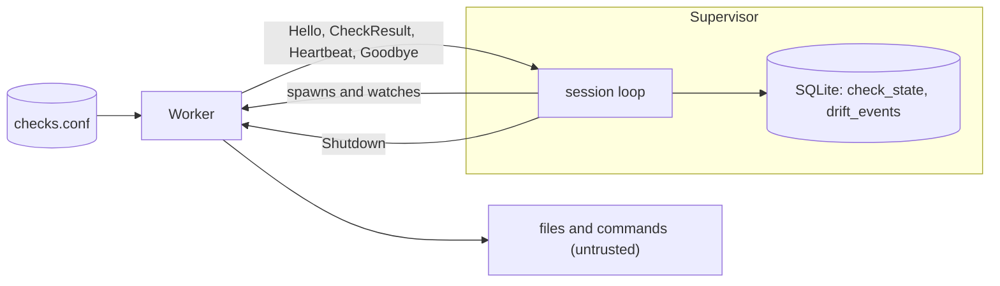

# oathwatch

A small cross-platform C++17 **endpoint agent**. A *supervisor* process owns a SQLite state store and watches a *worker* process that evaluates desired-state checks and reports over IPC (a named pipe on Windows, a Unix domain socket elsewhere). It records **drift**: when a check flips between compliant and noncompliant.

*The name: an oath is the declared desired state, and the watch holds the machine to it.*

> **The source is private.** This repo has the design, security review, test evidence and three code excerpts. Full source available on request.
>
> *[TESTING](docs/TESTING.md) says exactly how the results were produced.*

## The idea

The worker reads arbitrary files and runs arbitrary commands, so it is treated as something that can **crash, hang, or lie**:

- The state owner never touches risky input.
- Every wait has a deadline; a hung worker is killed, a crashed one restarted with backoff.
- Everything the worker sends is validated, and only the exact process the supervisor started may connect.
- The config file is treated as code, because a command check makes the agent run a program.

## Read next

| time | read |
|---|---|
| 5 min | [Decisions](docs/DECISIONS.md): ten design choices and what each cost |
| deeper | [Architecture](docs/ARCHITECTURE.md), [Security review](docs/SECURITY.md), [Testing](docs/TESTING.md) |
| code | [Excerpts](excerpts/): session loop, RAII and constructor exceptions, process-tree timeouts |

## Verified, and not

**Verified:** 85 unit and 27 integration tests (Linux), 92% line coverage, clean under AddressSanitizer and UBSan, 20 mutation tests, and the portable tests pass on Windows (MSVC).

**Not verified:** the Windows pipe access-control list and the hostile-peer tests have no Windows coverage yet; macOS is untested; the security review is a self-review, not an audit; gRPC is not implemented.

C++17, CMake, vcpkg, SQLite, GoogleTest, Windows overlapped named pipes, POSIX sockets, `fork`/`exec`, Win32 job objects.
