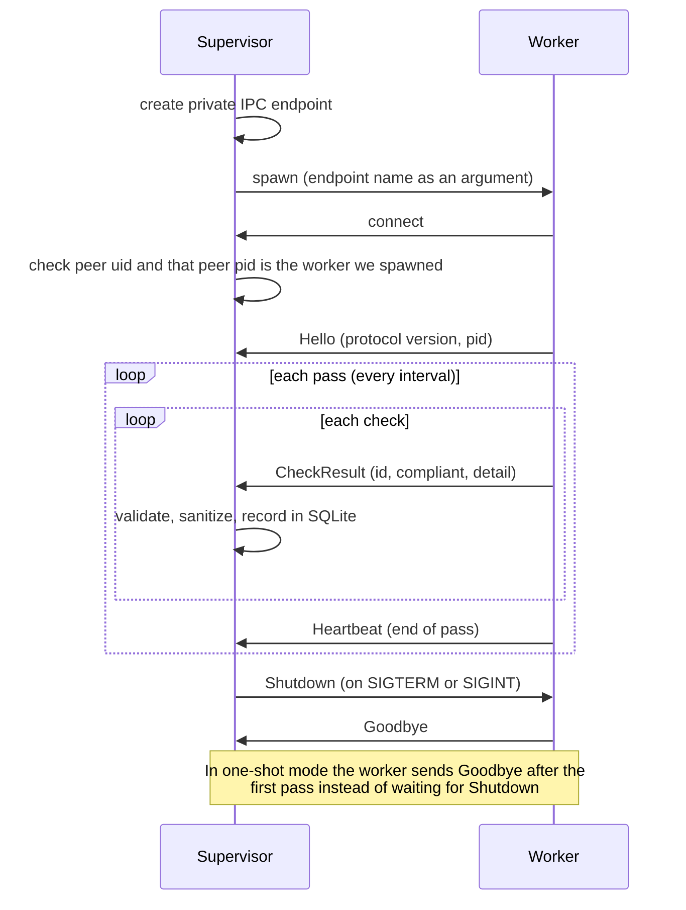
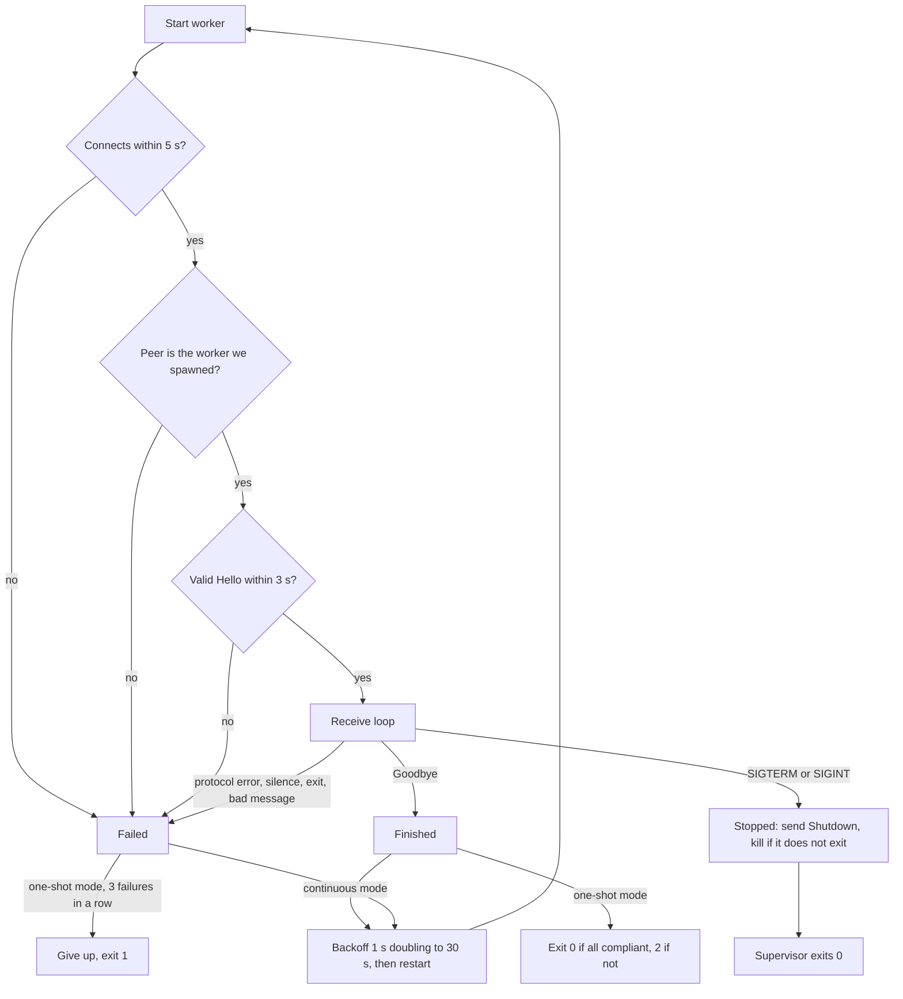

# Architecture

> The full source is private. See the [excerpts](../excerpts/) for representative code.

**Terms.** *Supervisor*: the long-running process that owns the state database and starts, watches and restarts the worker. *Worker*: the process it starts to evaluate checks (in code it is a `ChildProcess` handle named `child`; "child" describes the relationship, "worker" the job). *Check command*: a program a `command_ok` check runs. *Grandchild*: a process a check command starts.

## One session

## How a session ends

## IPC contract (version 1)

**Transport.** One connection per worker. Windows: an overlapped named pipe with an explicit access-control list, remote clients rejected. POSIX: a Unix domain socket (mode 0600) in a private `mkdtemp` directory (mode 0700).

**Frame.** `u32 length (little-endian) | u8 type | payload`, where length counts the type byte plus the payload, 1 to 1 MiB. Payload: `key=value` lines, with newline and backslash escaped.

| type | message | direction | fields |
|---|---|---|---|
| 1 | Hello | worker to supervisor | version, pid, role |
| 2 | CheckResult | worker to supervisor | id, compliant, detail |
| 3 | Heartbeat | worker to supervisor | seq (sent at the end of each pass) |
| 4 | Shutdown | supervisor to worker | none |
| 5 | Goodbye | worker to supervisor | none |

**Rules.** `Hello` comes first, within 3 s, with a matching version. Any malformed frame, unknown type or unexpected message ends the session. Unknown *fields* are ignored, so fields can be added without a version bump. The listener rejects other users, and the supervisor requires the peer pid to equal the worker it spawned. Everything the worker sends is untrusted: ids validated, text sanitized and capped, and the supervisor uses its own clock.

## Failure handling

| failure | detected by | response |
|---|---|---|
| worker will not start | process exits before connecting | restart with backoff; one-shot mode gives up after 3 |
| worker crashes | process gone or channel closed | read queued messages, then restart (1 s doubling to 30 s; reset after a 30 s healthy session) |
| worker hangs | no message for `2 * interval + 15` s, in every mode | kill the process tree, restart |
| something else connects | peer pid or uid mismatch | reject, kill the worker, restart |
| garbage on the wire | decoder throws `ProtocolError` | drop the connection, restart |
| supervisor killed | worker sees its channel close | worker exits |
| SIGTERM or SIGINT | signal flag | send `Shutdown`, wait 2 s, then kill |
| config unsafe or empty | checked at startup and every pass | supervisor refuses to start; worker reports nothing |

## State

SQLite in WAL mode, written only by the supervisor. `check_state` holds the latest result per check. `drift_events` is appended only on a first baseline or a compliance flip, so it is the drift history, not a log of every pass.
